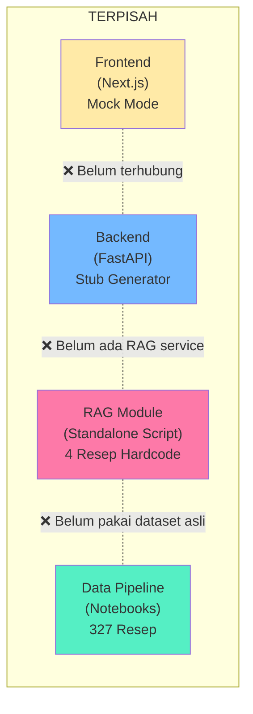
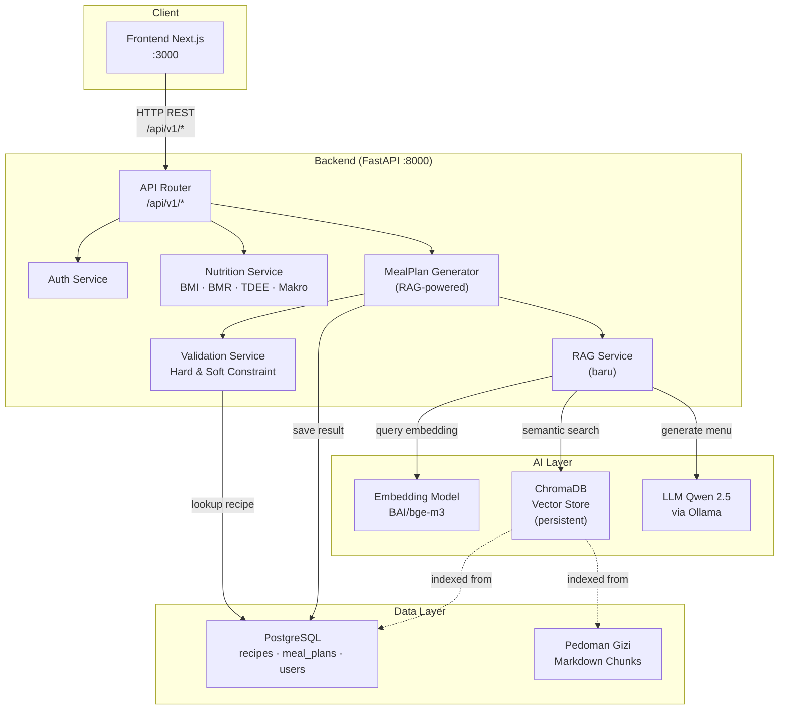
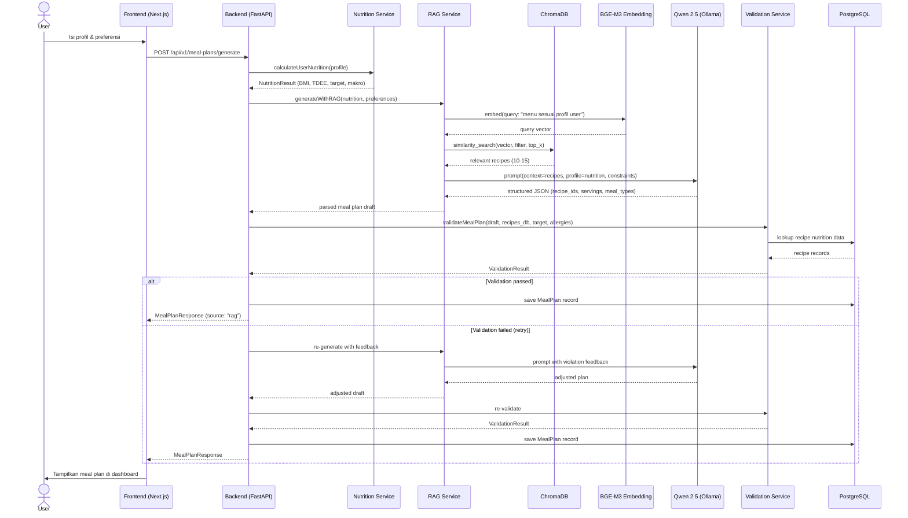

# PRD — DietMate AI: Personalized Diet Planner Berbasis Generative AI

> **Versi:** 1.0 &nbsp;|&nbsp; **Tanggal:** 23 November 2026
> **Tujuan Utama:** Mengintegrasikan frontend (Next.js), backend (FastAPI), data pipeline, dan modul RAG (LangChain + ChromaDB + LLM) menjadi satu sistem end-to-end yang mampu menghasilkan rekomendasi menu diet personal berbasis Generative AI.

---

## Daftar Isi

1. [Ringkasan Eksekutif](#1-ringkasan-eksekutif)
2. [Peta Kondisi Saat Ini (As-Is)](#2-peta-kondisi-saat-ini-as-is)
3. [Arsitektur Target (To-Be)](#3-arsitektur-target-to-be)
4. [Roadmap Integrasi (5 Phase)](#4-roadmap-integrasi-5-phase)
5. [Kontrak API Terpadu](#5-kontrak-api-terpadu)
6. [Data Flow End-to-End](#6-data-flow-end-to-end)
7. [Gap Analysis & Risiko](#7-gap-analysis--risiko)
8. [Kriteria Penerimaan (Definition of Done)](#8-kriteria-penerimaan-definition-of-done)

---

## 1. Ringkasan Eksekutif

DietMate AI adalah sistem rekomendasi menu diet personal yang menggabungkan:

- **Frontend mobile-first** (Next.js 14 + Tailwind CSS) — UI onboarding, profil, preferensi diet, generate meal plan, dan dashboard.
- **Backend API** (FastAPI + PostgreSQL) — perhitungan nutrisi (BMI/BMR/TDEE/makro), validasi meal plan (hard & soft constraint), dan penyimpanan hasil.
- **Data Pipeline** (Jupyter notebooks) — cleaning resep, ekstraksi pedoman gizi Kemenkes, loading ke PostgreSQL, indexing ke ChromaDB.
- **Modul RAG** (LangChain + ChromaDB + BGE-M3 + Qwen 2.5/Ollama) — retrieval resep semantik dan generasi menu oleh LLM.

Saat ini keempat komponen dikembangkan terpisah oleh orang yang berbeda. Dokumen ini memetakan langkah strategis untuk mengintegrasikan semuanya menjadi satu pipeline fungsional.

---

## 2. Peta Kondisi Saat Ini (As-Is)

### 2.1 Struktur Folder

```
data_dietmate/
├── backend/                  # FastAPI backend (Python 3.10)
│   ├── app/
│   │   ├── api/routes/       # health, nutrition, mealplan
│   │   ├── core/config.py    # pydantic-settings (.env)
│   │   ├── db/               # database.py, session.py, load_recipes.py
│   │   ├── models/           # Recipe, MealPlan (SQLAlchemy ORM)
│   │   ├── schemas/          # nutrition, mealplan, user (Pydantic v2)
│   │   └── services/         # bmi, calorie, macro, nutrition, validation, mealplan
│   ├── tests/                # pytest (6 file test)
│   ├── requirements.txt
│   └── .env / .env.example
├── frontend/                 # Next.js 14 + React 18 + Tailwind
│   ├── src/
│   │   ├── app/              # 12 route pages (onboarding → dashboard)
│   │   ├── components/       # auth, brand, dashboard, generating, navigation,
│   │   │                     # onboarding, plan, preferences, profile,
│   │   │                     # recipes, settings, ui
│   │   ├── lib/
│   │   │   ├── api/          # client.ts, auth.ts (mock / real API)
│   │   │   ├── mock/         # meal-plan.ts (data demo statis)
│   │   │   ├── nutrition/    # preview.ts (kalkulasi BMI/BMR/TDEE lokal)
│   │   │   └── storage/      # session.ts (sessionStorage)
│   │   └── types/            # dietmate.ts, auth.ts
│   └── package.json
├── rag/                      # Prototipe RAG mandiri
│   ├── RAG.py                # script end-to-end (hardcoded 4 resep)
│   ├── requirements.txt
│   └── README.md
├── dataset/
│   ├── cleaned_recipes.csv   # 327 resep bersih (12 kolom)
│   ├── diet_mate_recipes.csv # dataset mentah
│   └── nourish_recipes.csv   # dataset mentah tambahan
├── doc/                      # Pedoman gizi Kemenkes (extracted markdown)
│   ├── pedoman_gizi_lengkap.md
│   ├── extracted_bab2_pedoman_gizi.md
│   ├── extracted_permenkes_akg_2019.md
│   └── extracted_permenkes_gizi_seimbang_2014.md
├── 01_clean_recipes.ipynb    # Notebook: pembersihan resep
├── 02_prepare_guidelines.ipynb  # Notebook: ekstraksi pedoman gizi dari PDF
├── 03_load_postgres.ipynb    # Notebook: load ke PostgreSQL
├── 04_index_chromadb.ipynb   # Notebook: indexing ke ChromaDB
├── 05_test_pipeline.ipynb    # Notebook: pengujian pipeline
├── 2014permenkes041.pdf      # Permenkes Pedoman Gizi Seimbang
└── 2019permenkes028.pdf      # Permenkes AKG 2019
```

### 2.2 Status per Komponen

| Komponen | Status | Catatan |
|----------|--------|---------|
| **Frontend** | ✅ Fungsional (mock mode) | Semua halaman UI bekerja, mock API aktif (`USE_MOCK_API=true`), 6 resep demo hardcode. Belum terhubung ke backend nyata. |
| **Backend** | ✅ Fungsional (stub) | Endpoint `/nutrition/calculate`, `/nutrition/validate` sudah tervalidasi. Endpoint `/mealplan/generate` masih **stub** (round-robin dari DB, belum RAG). Ada 6 test file, 327 resep di PostgreSQL. |
| **Data Pipeline** | ✅ Siap | 5 notebook berurutan, 327 resep bersih, 4 dokumen pedoman gizi. Notebook 04 (ChromaDB indexing) sudah ada. |
| **RAG Module** | ⚠️ Prototipe awal | Hanya 4 resep hardcode, ChromaDB non-persistent, tidak ada integrasi ke FastAPI, output teks mentah. |

### 2.3 Gap Utama yang Teridentifikasi



---

## 3. Arsitektur Target (To-Be)



---

## 4. Roadmap Integrasi (5 Phase)

> [!IMPORTANT]
> Setiap phase memiliki deliverable yang bisa diuji secara independen. Urutan ini dirancang agar setiap langkah membangun di atas fondasi yang sudah stabil.

---

### Phase 1: Stabilisasi Fondasi & Koneksi Frontend ↔ Backend

**Goal:** Frontend dan Backend bisa berkomunikasi end-to-end menggunakan data nyata dari PostgreSQL (tanpa RAG/LLM).

#### Tugas

| # | Tugas | Komponen | Detail |
|---|-------|----------|--------|
| 1.1 | **Harmonisasi kontrak API** | FE + BE | Frontend mengharapkan `POST /api/v1/meal-plans/generate` dengan payload `GenerateMealPlanRequest` dan respons `MealPlanResponse`. Backend saat ini menggunakan `POST /mealplan/generate` dengan schema `MealPlanRequest` / `MealPlanResponse` yang berbeda. Perlu menyamakan path, request body, dan response body. |
| 1.2 | **Tambah prefix `/api/v1`** di backend | BE | Tambahkan `APIRouter(prefix="/api/v1")` sebagai parent router agar seluruh endpoint berada di bawah `/api/v1/*`. |
| 1.3 | **Tambah endpoint auth** di backend | BE | Frontend memanggil `POST /api/v1/auth/register`, `POST /api/v1/auth/login`, `POST /api/v1/auth/logout`. Implementasi minimal (session-based atau JWT sederhana) + tabel `users`. |
| 1.4 | **Mapping tipe data** FE → BE | FE + BE | Selaraskan field: FE `UserProfile.pal` → BE `activity_level`; FE `DietGoal` (`weight_loss`/`maintenance`/`muscle_gain`) → BE `diet_goal` (`lose_weight`/`maintain`/`gain_muscle`); FE `source: "mock" \| "rag"` → BE `validation_status`. |
| 1.5 | **Konfigurasi CORS & env** | BE + FE | Pastikan `CORS_ORIGINS` backend menerima `localhost:3000`. Set `NEXT_PUBLIC_API_BASE_URL=http://localhost:8000` dan `NEXT_PUBLIC_USE_MOCK_API=false` di frontend `.env.local`. |
| 1.6 | **End-to-end test manual** | Semua | Jalankan backend + frontend, lakukan alur: Register → Login → Profil → Preferensi → Generate → Dashboard. Verifikasi data mengalir dari UI ke backend dan kembali. |

#### Deliverable Phase 1
- [ ] Frontend bisa generate meal plan dari backend (stub, tanpa RAG) dengan data 327 resep nyata
- [ ] Auth flow berfungsi (register/login/logout)
- [ ] Tidak ada data mock/hardcode yang dipakai saat mode production

---

### Phase 2: Data Pipeline — Indexing Resep & Pedoman Gizi ke ChromaDB

**Goal:** Seluruh 327 resep dan dokumen pedoman gizi ter-index di ChromaDB (persistent) dan bisa di-query secara semantik.

#### Tugas

| # | Tugas | Komponen | Detail |
|---|-------|----------|--------|
| 2.1 | **Finalisasi notebook 04** | Data | Pastikan notebook `04_index_chromadb.ipynb` membaca `cleaned_recipes.csv` dan menghasilkan persistent ChromaDB collection (`resep_dietmate`) di path `chroma_db/`. |
| 2.2 | **Indexing pedoman gizi** | Data | Chunk dokumen `doc/*.md` (terutama `pedoman_gizi_lengkap.md`, AKG 2019) dan masukkan ke collection `pedoman_gizi` di ChromaDB. |
| 2.3 | **Embedding model** | Data | Gunakan `BAAI/bge-m3` (sesuai proposal) konsisten di semua tempat. Pastikan dimensi embedding sama antara indexing dan query. |
| 2.4 | **Metadata enrichment** | Data | Tambahkan metadata pada setiap document chunk: `recipe_id`, `kategori`, `kalori_kkal`, `protein_g`, `karbohidrat_g`, `lemak_g`, `allergens` (extracted dari `bahan_bahan`). Ini memungkinkan filtered search. |
| 2.5 | **Validasi retrieval** | Data | Uji query semantik: "menu sarapan tinggi protein", "resep rendah kalori tanpa udang" → verifikasi resep yang dikembalikan relevan dan benar. |
| 2.6 | **Script indexing CLI** | Data + BE | Buat script `backend/app/db/index_chromadb.py` yang bisa dijalankan via CLI (`python -m app.db.index_chromadb`) untuk re-index ulang tanpa notebook. |

#### Deliverable Phase 2
- [ ] ChromaDB persistent di `chroma_db/` dengan 327+ dokumen resep + chunks pedoman gizi
- [ ] Retrieval test menunjukkan hasil semantik yang relevan
- [ ] Script CLI untuk re-indexing tersedia

---

### Phase 3: Integrasi RAG Service ke Backend FastAPI

**Goal:** Backend memiliki RAG service yang menggunakan ChromaDB + LLM untuk menghasilkan meal plan cerdas, menggantikan stub generator.

#### Tugas

| # | Tugas | Komponen | Detail |
|---|-------|----------|--------|
| 3.1 | **Buat `app/services/rag_service.py`** | BE | Pindahkan & refactor logika dari `rag/RAG.py` menjadi service class yang proper: singleton ChromaDB client, retriever, LLM chain. |
| 3.2 | **Konfigurasi RAG di `.env`** | BE | Tambahkan: `CHROMA_DB_PATH`, `EMBEDDING_MODEL`, `LLM_MODEL`, `OLLAMA_BASE_URL`, `RAG_TOP_K`, `LLM_TEMPERATURE`. |
| 3.3 | **Desain prompt template** | BE | Buat prompt yang menyertakan: (a) konteks resep dari retriever, (b) profil nutrisi user (BMI/TDEE/target kalori/makro), (c) daftar alergi & preferensi, (d) instruksi output format JSON. |
| 3.4 | **Structured output parsing** | BE | LLM harus mengembalikan JSON terstruktur (daftar `recipe_id`, `servings`, `meal_type` per hari). Gunakan `PydanticOutputParser` atau regex fallback untuk memastikan output valid. |
| 3.5 | **Upgrade `mealplan_service.py`** | BE | Ganti `generate_meal_plan_stub()` → `generate_meal_plan_rag()`. Pipeline: (1) hitung nutrisi user, (2) query ChromaDB untuk resep relevan, (3) kirim ke LLM dengan prompt, (4) parse output, (5) validasi dengan `validation_service`, (6) retry jika gagal validasi, (7) simpan ke PostgreSQL. |
| 3.6 | **Fallback mechanism** | BE | Jika LLM/Ollama tidak tersedia atau response invalid setelah N retry: fallback ke stub generator (round-robin). Set flag `source: "rag" \| "stub"` di response. |
| 3.7 | **Dependencies update** | BE | Tambahkan ke `requirements.txt`: `langchain-huggingface`, `langchain-chroma`, `langchain-community`, `langchain-core`, `sentence-transformers`, `chromadb`. |
| 3.8 | **Unit & integration test** | BE | Test RAG service: mock ChromaDB, mock LLM, test parsing, test fallback, test validasi output. |

#### Deliverable Phase 3
- [ ] `POST /api/v1/meal-plans/generate` menghasilkan meal plan dari RAG pipeline
- [ ] Output LLM terparse menjadi `MealPlanResponse` yang valid
- [ ] Validasi nutrisi (hard & soft constraint) tetap berjalan
- [ ] Fallback ke stub berfungsi saat LLM tidak tersedia

---

### Phase 4: Optimasi Retrieval & Kualitas Rekomendasi

**Goal:** Meningkatkan relevansi dan kualitas rekomendasi menu yang dihasilkan oleh pipeline RAG.

#### Tugas

| # | Tugas | Komponen | Detail |
|---|-------|----------|--------|
| 4.1 | **Filtered retrieval** | BE | Implementasi metadata filter di ChromaDB query: filter berdasarkan `kategori`, rentang `kalori_kkal`, exclude alergen — sebelum similarity search. Ini mengurangi beban LLM. |
| 4.2 | **Multi-query retrieval** | BE | Buat 3 query terpisah per meal slot (sarapan/makan siang/makan malam) agar retrieval lebih terfokus pada jenis makanan yang sesuai. |
| 4.3 | **Re-ranking** | BE | Setelah retrieval, re-rank berdasarkan: (a) skor kesamaan semantik, (b) kedekatan kalori per porsi dengan target, (c) kecocokan preferensi user, (d) variasi (hindari duplikat). |
| 4.4 | **Prompt engineering** | BE | Iterasi prompt: tambahkan few-shot examples, instruksi distribusi nutrisi per waktu makan (sarapan ≈25%, makan siang ≈35%, makan malam ≈30%, snack ≈10% dari TDEE). |
| 4.5 | **Pedoman gizi sebagai konteks** | BE | Sertakan chunk relevan dari `pedoman_gizi` collection sebagai tambahan konteks agar LLM mempertimbangkan Pedoman Gizi Seimbang dan AKG Kemenkes. |
| 4.6 | **Evaluation framework** | BE + Data | Buat set evaluasi: 20+ skenario user (berbagai profil, alergi, tujuan diet) → bandingkan output RAG vs stub → ukur: validasi pass rate, deviasi nutrisi, variasi resep, waktu respons. |

#### Deliverable Phase 4
- [ ] Filtered + multi-query retrieval meningkatkan relevansi resep
- [ ] Validation pass rate ≥ 80% (soft constraint within tolerance)
- [ ] Deviasi nutrisi rata-rata ≤ 15% dari target
- [ ] Variasi resep: tidak ada duplikat dalam 3 hari berturut-turut

---

### Phase 5: Polish, Auth Lengkap, & Deployment Readiness

**Goal:** Sistem siap untuk demo/presentasi end-to-end dengan user experience yang mulus.

#### Tugas

| # | Tugas | Komponen | Detail |
|---|-------|----------|--------|
| 5.1 | **Response schema alignment** | FE + BE | Pastikan `MealPlanResponse` dari backend 100% kompatibel dengan `MealPlanResponse` di frontend types (termasuk field `source`, `generated_at`, `nutrition_summary`, `validation`). |
| 5.2 | **Loading state & streaming** | FE | RAG generation bisa memakan waktu 10-30 detik. Implementasi: (a) loading animation yang informatif, (b) opsional SSE/WebSocket untuk streaming progress. |
| 5.3 | **Error handling** | FE + BE | Handle semua error case: Ollama down, DB connection lost, invalid LLM output, timeout. Tampilkan pesan user-friendly di frontend. |
| 5.4 | **Tabel `users` & profil persistence** | BE | Simpan user profile, preferences, dan history meal plan di PostgreSQL (bukan hanya sessionStorage). |
| 5.5 | **Dashboard enhancements** | FE | Tampilkan sumber meal plan (`source: "rag"` vs `"stub"`), riwayat plan sebelumnya, detail validasi. |
| 5.6 | **Environment & deployment** | Semua | Buat `docker-compose.yml` dengan services: `frontend`, `backend`, `postgres`, `chromadb`, `ollama`. Satu perintah untuk menjalankan seluruh stack. |
| 5.7 | **Dokumentasi** | Semua | Update README utama dengan: arsitektur, cara setup, cara menjalankan, troubleshooting. |

#### Deliverable Phase 5
- [ ] Demo end-to-end: Register → Profil → Preferensi → Generate (RAG) → Dashboard
- [ ] Waktu generate ≤ 30 detik dengan loading UX yang baik
- [ ] Docker Compose satu perintah untuk seluruh stack
- [ ] README komprehensif

---

## 5. Kontrak API Terpadu

> [!NOTE]
> Kontrak ini menjadi acuan bersama antara frontend dan backend. Setiap perubahan harus disepakati kedua sisi.

### 5.1 Endpoint yang Disepakati

| Method | Path | Request | Response | Prioritas |
|--------|------|---------|----------|-----------|
| `POST` | `/api/v1/auth/register` | `RegisterPayload` | `{ user: DietMateUser }` | Phase 1 |
| `POST` | `/api/v1/auth/login` | `LoginPayload` | `AuthResult` | Phase 1 |
| `POST` | `/api/v1/auth/logout` | — | `{ message: string }` | Phase 1 |
| `POST` | `/api/v1/nutrition/calculate` | `UserProfile` | `NutritionResult` | Phase 1 |
| `POST` | `/api/v1/nutrition/validate` | `MealPlanValidationRequest` | `ValidationResult` | Phase 1 |
| `POST` | `/api/v1/meal-plans/generate` | `GenerateMealPlanRequest` | `MealPlanResponse` | Phase 1–3 |
| `GET`  | `/api/v1/meal-plans/{id}` | — | `MealPlanResponse` | Phase 1 |
| `GET`  | `/api/v1/meal-plans/history` | query: `user_id` | `MealPlanResponse[]` | Phase 5 |
| `GET`  | `/health` | — | `{ status: "ok" }` | Sudah ada |

### 5.2 Request Body — Generate Meal Plan (Unified)

```json
{
  "profile": {
    "age": 25,
    "gender": "male",
    "height_cm": 175.0,
    "weight_kg": 70.0,
    "activity_level": "moderate",
    "pal": 1.55
  },
  "preferences": {
    "goal": "weight_loss",
    "duration_days": 7,
    "allergies": ["udang", "kacang"],
    "food_preferences": ["ayam", "sayuran"]
  }
}
```

### 5.3 Response Body — MealPlanResponse (Unified)

```json
{
  "plan_id": "MP_abc123def456",
  "source": "rag",
  "generated_at": "2026-11-23T15:30:00Z",
  "nutrition_summary": {
    "bmi": 22.86,
    "bmi_category": "Normal",
    "bmr_kcal": 1673.75,
    "tdee_kcal": 2594.31,
    "target_calories_kcal": 2094.31,
    "calories_kcal": 2094.31,
    "protein_g": 104.72,
    "carbs_g": 288.47,
    "fat_g": 69.81
  },
  "days": [
    {
      "day_number": 1,
      "meals": [
        {
          "meal_type": "breakfast",
          "servings": 1.5,
          "recipe": {
            "id": "RCP_0042",
            "name": "Oatmeal Pisang",
            "description": "...",
            "prep_time_minutes": 15,
            "servings": 1,
            "ingredients": ["..."],
            "instructions": ["..."],
            "tags": ["Sarapan"]
          },
          "nutrition": {
            "calories_kcal": 375.0,
            "protein_g": 12.5,
            "carbs_g": 60.0,
            "fat_g": 8.5
          }
        }
      ],
      "totals": {
        "calories_kcal": 2080.0,
        "protein_g": 102.0,
        "carbs_g": 285.0,
        "fat_g": 68.5
      }
    }
  ],
  "validation": {
    "passed": true,
    "warnings": []
  }
}
```

---

## 6. Data Flow End-to-End



---

## 7. Gap Analysis & Risiko

### 7.1 Gap Analysis Detail

| # | Gap | Dampak | Solusi | Phase |
|---|-----|--------|--------|-------|
| G1 | **API path mismatch** — FE memanggil `/api/v1/meal-plans/generate`, BE melayani `/mealplan/generate` | Frontend tidak bisa terhubung ke backend | Tambahkan `/api/v1` prefix; rename route `/mealplan` → `/meal-plans` | 1 |
| G2 | **Schema mismatch** — FE `GenerateMealPlanRequest` (profile + preferences) ≠ BE `MealPlanRequest` (user_profile + duration_days + meals_per_day) | Parsing error saat request/response | Selaraskan schema atau buat adapter layer | 1 |
| G3 | **Field naming mismatch** — FE `weight_loss`/`maintenance`/`muscle_gain` ≠ BE `lose_weight`/`maintain`/`gain_muscle`; FE `pal` (number) ≠ BE `activity_level` (enum) | Kalkulasi nutrisi salah | Mapping di backend atau standarisasi naming | 1 |
| G4 | **Auth belum ada di backend** | Frontend auth flow tidak bisa jalan saat mock dimatikan | Implementasi auth endpoints minimal | 1 |
| G5 | **RAG terpisah & hardcoded** — `rag/RAG.py` hanya punya 4 resep, tidak terhubung ke dataset 327 resep atau FastAPI | Generasi meal plan tidak cerdas | Integrasi RAG ke backend service | 2–3 |
| G6 | **ChromaDB non-persistent** — RAG prototype menggunakan in-memory ChromaDB | Data hilang setiap restart | Gunakan persistent ChromaDB client | 2 |
| G7 | **LLM output tidak terstruktur** — RAG prototype menghasilkan teks bebas | Tidak bisa diparse menjadi structured meal plan | Desain prompt + output parser | 3 |
| G8 | **Response body mismatch** — BE `MealPlanResponse` ≠ FE `MealPlanResponse` (field names, nesting berbeda) | Frontend tidak bisa render data dari backend | Harmonisasi response schema | 1, 5 |

### 7.2 Risiko Teknis

| Risiko | Probabilitas | Dampak | Mitigasi |
|--------|-------------|--------|----------|
| **Ollama/LLM tidak tersedia** saat demo | Sedang | Tinggi | Fallback ke stub generator; flag `source` di response |
| **LLM menghasilkan recipe_id yang tidak ada** di database | Tinggi | Sedang | Validasi output terhadap DB; retry dengan feedback |
| **Waktu respons RAG > 30 detik** | Sedang | Sedang | Cache embedding, filter sebelum retrieval, streaming UI |
| **BGE-M3 download besar** (~2 GB pertama kali) | Rendah | Rendah | Pre-download saat setup; dokumentasikan di README |
| **Nutrisi tidak seimbang** dari output LLM | Tinggi | Tinggi | Validasi otomatis + retry loop (maks 3 kali) |

---

## 8. Kriteria Penerimaan (Definition of Done)

> [!TIP]
> Gunakan checklist ini untuk menentukan apakah setiap phase sudah selesai.

### Per Phase

| Phase | Kriteria | Metode Verifikasi |
|-------|----------|-------------------|
| **1** | Frontend menampilkan meal plan dari backend (bukan mock) | Manual test: matikan mock, generate plan, verifikasi data berasal dari 327 resep DB |
| **1** | Auth flow berfungsi | Manual test: register → login → logout → login lagi |
| **2** | ChromaDB berisi 327+ dokumen resep | Script test: `collection.count() >= 327` |
| **2** | Retrieval test relevan | Query "sarapan tinggi protein" → ≥ 60% hasil relevan |
| **3** | Meal plan dari RAG terparse valid | Integration test: response sesuai schema `MealPlanResponse` |
| **3** | Validasi tetap berjalan | Integration test: hard constraint (alergen) selalu terdeteksi |
| **3** | Fallback berfungsi | Test: matikan Ollama → endpoint tetap mengembalikan response (dari stub) |
| **4** | Validation pass rate ≥ 80% | Evaluasi 20 skenario user |
| **4** | Variasi resep cukup | Tidak ada resep duplikat dalam 3 hari berurutan |
| **5** | Demo end-to-end lancar | Walkthrough lengkap tanpa error |
| **5** | Docker Compose berjalan | `docker compose up` → semua service berjalan |

### Keseluruhan Sistem (Definition of Done Final)

- [ ] User bisa register, login, isi profil, pilih preferensi diet
- [ ] Sistem menghitung BMI, BMR, TDEE, target kalori, dan makronutrien secara akurat (standar Kemenkes RI)
- [ ] Meal plan dihasilkan oleh RAG pipeline (ChromaDB retrieval + LLM generation)
- [ ] Meal plan divalidasi (alergen, nutrisi, variasi resep) sebelum disajikan ke user
- [ ] Dashboard menampilkan meal plan harian lengkap dengan detail resep dan nutrisi
- [ ] Sistem graceful fallback saat komponen AI tidak tersedia
- [ ] Semua komponen bisa dijalankan bersama dengan satu perintah

---

> [!CAUTION]
> **Catatan Penting:** PRD ini bersifat iteratif. Prioritaskan Phase 1 (koneksi FE↔BE) terlebih dahulu karena ini adalah fondasi untuk semua phase selanjutnya. Jangan melompat ke integrasi RAG sebelum kontrak API disepakati dan frontend bisa berkomunikasi dengan backend menggunakan data nyata.
